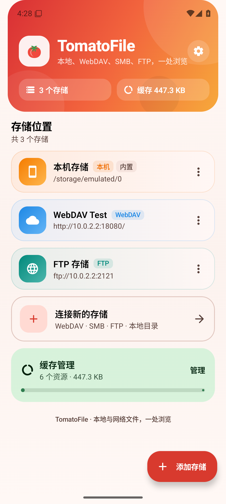
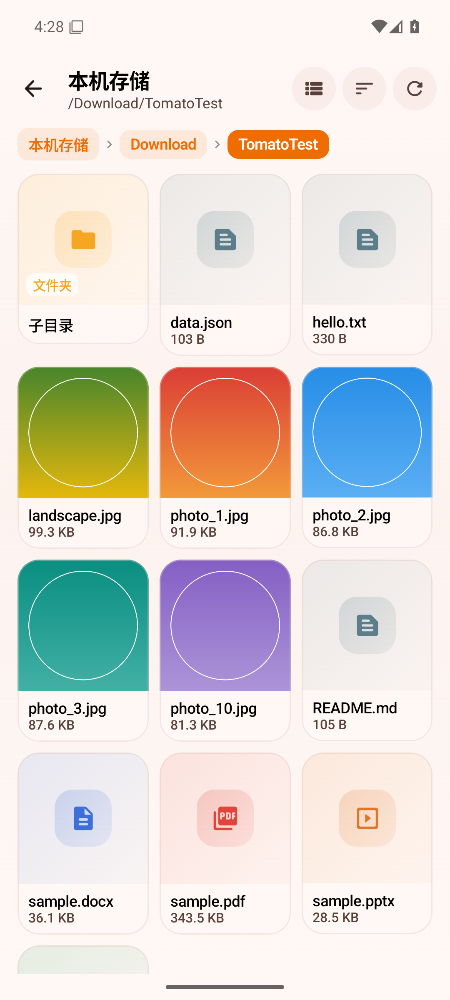
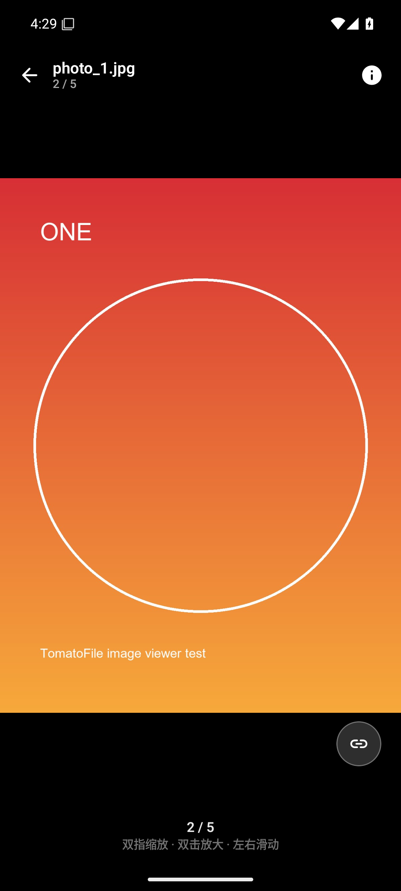
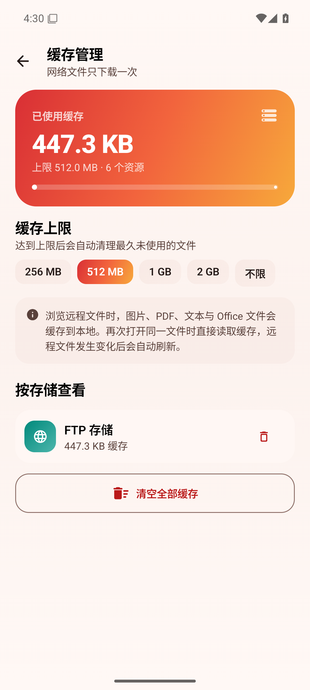
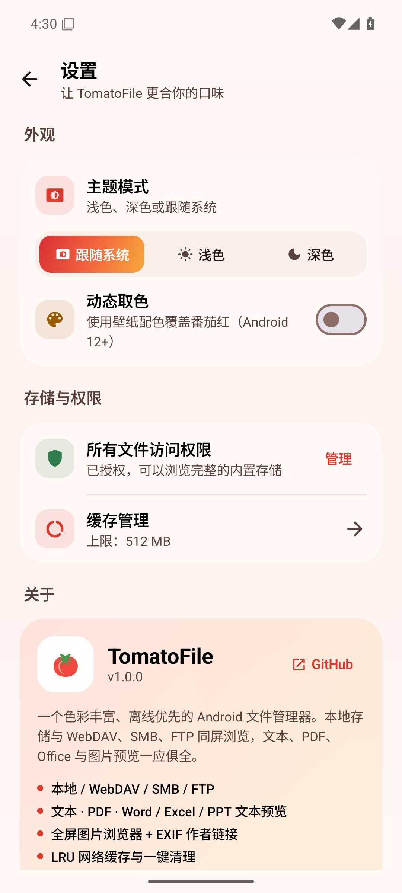

# TomatoFile 🍅

一个用 **Kotlin + Jetpack Compose + Material 3** 打造的 Android 文件管理器。  
把本地文件与 WebDAV、SMB、FTP 放进同一个色彩丰富的界面里，随时随地浏览、预览和看图片。

[](https://github.com/cctomato03/TomatoFile/actions/workflows/android-release.yml)
[](https://github.com/cctomato03/TomatoFile/releases)

## 功能

- **多协议存储配置**：本机目录、WebDAV、SMB 2/3、FTP / FTPS，都可以按配置添加、编辑、删除。
- **逐级浏览**：面包屑导航、文件夹优先排序、列表 / 网格视图、按名称 / 时间 / 大小 / 类型排序。
- **文件预览**：
  - 文本 / 代码 / Markdown / JSON / 日志等，带行号、编码识别与 UTF-8 → GB18030 回退；
  - PDF 使用系统 `PdfRenderer` 逐页渲染；
  - DOCX / XLSX / PPTX（以及 ODT / ODS / ODP）离线提取文本预览，不依赖网络和第三方转换服务。
- **全屏图片浏览器**：
  - 同一目录下的所有图片自动组成可左右滑动的图片流；
  - 双指缩放、双击放大/还原、放大后拖动；
  - 图片加载成功后，右下角出现小链接按钮：读取 EXIF/XMP 元数据，提取作者信息并通过系统 `ACTION_VIEW` 打开链接（纯名字/邮箱会转为搜索链接）；
  - 顶部信息按钮查看完整元数据（分辨率、相机、拍摄时间、位置、作者、版权等）。
- **网络缓存**：
  - 远程文件按 `sourceId + path` 缓存到应用私有目录，并用远端修改时间 / 大小做校验；
  - 同一个文件并发请求只下载一次；
  - LRU 自动清理，可设置 256MB～2GB 或不限；
  - 缓存管理页可查看总占用、按存储查看、清空全部或单个存储；同时清理 Coil 缩略图磁盘缓存。
- **Material 3 设计**：番茄红渐变、按协议/文件类型配色、圆角卡片、深浅主题与 Android 12+ 动态取色。

## 截图

| 首页 | 文件浏览 |
| --- | --- |
|  |  |

| 图片查看器（右下角作者链接） | 缓存管理 |
| --- | --- |
|  |  |



## 技术栈

| 模块 | 选型 |
| --- | --- |
| UI | Jetpack Compose + Material 3 + Navigation Compose |
| 异步 | Kotlin Coroutines / StateFlow |
| 图片 | Coil 2（含 GIF 解码） |
| WebDAV | OkHttp + 自实现 PROPFIND / GET 流式读取 |
| SMB | [SMBJ](https://github.com/hierynomus/smbj) 0.13（SMB2/3） |
| FTP | Apache Commons Net（FTP / 显式 FTPS） |
| PDF | `android.graphics.pdf.PdfRenderer` |
| Office | 自实现 OOXML / ODF ZIP+XML 文本提取 |
| 凭据 | Android Keystore + AES/GCM |
| 缓存 | 自实现 LRU 文件缓存 + JSON 索引 |

## 项目结构

```
app/src/main/java/com/cctomato/tomatofile/
├── data/
│   ├── cache/        远程资源磁盘缓存 + LRU
│   ├── crypto/       Android Keystore 加密
│   ├── fs/           本地 / WebDAV / SMB / FTP 客户端
│   ├── image/        EXIF 元数据读取
│   ├── model/        数据模型与文件类型分类
│   ├── preview/      文本、Office、PDF 渲染
│   ├── repo/         客户端管理与按需下载
│   └── store/        存储配置与用户设置
├── ui/
│   ├── browse/       文件浏览器
│   ├── cache/        缓存管理
│   ├── components/   通用 Material 3 组件
│   ├── home/         首页
│   ├── nav/          路由与 Base64 路径编码
│   ├── preview/      文本 / PDF / Office / 外部打开
│   ├── settings/     主题、权限、缓存、关于
│   ├── source/       添加 / 编辑存储
│   ├── theme/        品牌配色与字体
│   └── viewer/       全屏图片浏览器与缩放手势
└── util/             权限、格式化、链接、Intent 等工具
```

## 构建

环境：JDK 17+、Android SDK Platform 35、Build-Tools 35.0.0。

```bash
# Debug
./gradlew :app:assembleDebug

# Release（会自动使用 keystore/tomatofile-release.jks 签名）
TOMATO_STORE_PASSWORD=tomato-2026-release \
TOMATO_KEY_ALIAS=tomatofile \
TOMATO_KEY_PASSWORD=tomato-2026-release \
./gradlew :app:assembleRelease
```

产物位于 `app/build/outputs/apk/release/app-release.apk`。

> 仓库内的 `keystore/tomatofile-release.jks` 专用于这个个人项目的 CI 发布签名，密码写在 Gradle 配置中。  
> 如果你 Fork 后用于正式发布，请替换为自己的 keystore，并通过 GitHub Actions Secrets 注入密码。

## 自动发布流程

`.github/workflows/android-release.yml` 在 push 到 `main` / `master` 时：

1. 安装 JDK 17、Android SDK 35；
2. 用 `GITHUB_RUN_NUMBER` 生成版本号（`1.0.N`，versionCode = N）；
3. 构建签名 Release APK；
4. 生成 SHA-256 校验文件；
5. 创建 `v1.0.N` tag，发布 GitHub Release 并上传 APK 与校验文件。

也可以手动触发 `workflow_dispatch`。

## 使用提示

- **本机存储权限**：Android 11+ 需要「所有文件访问权限」（Settings → 应用 → TomatoFile → 所有文件访问权限）。这是独立分发文件管理器的常见做法；如果上架 Google Play，需要改用 SAF 目录授权。
- **WebDAV**：支持 Basic 认证与 HTTPS。兼容 Nextcloud / ownCloud / Alist / 群晖 / 坚果云等。
- **SMB**：SMB2 / SMB3，默认端口 445；需要填写共享名（例如 `shared`）与可选子目录。
- **FTP**：被动模式；可开启显式 TLS（FTPS）。证书使用系统信任链校验。
- **作者链接**：优先读取 EXIF `Artist` / `Copyright`；如果字段本身是 URL 就直接打开，否则回退到网页搜索。没有作者信息时会给出提示。

## 已知限制

- 旧版二进制 Office 格式（`.doc` / `.xls` / `.ppt`）不做内置解析，可用「其他应用打开」。
- WebDAV 目前使用 Basic 认证，不使用 Digest / OAuth。
- 暂不支持 SFTP（后续可基于 SSH 库扩展）。
- 图片作者信息依赖文件中的 EXIF/XMP 字段，不是所有图片都带有该信息。

## License

[MIT](LICENSE)